<p align="center">
  <a href="https://github.com/oddessentials/agent-guild-companions/releases/latest">
    <picture>
      <source media="(prefers-color-scheme: dark)" srcset=".github/assets/install-now-dark.svg" />
      <source media="(prefers-color-scheme: light)" srcset=".github/assets/install-now-light.svg" />
      
    </picture>
  </a>
</p>

# Grove Companion

A Grove spirit on your desktop, with no window round it, reacting to what your
[Agent Guild](https://github.com/oddessentials/agent-guild) sessions are doing. There is nothing to set up: it finds Agent Guild whenever that's running.

It works where you put it, and when everything goes quiet it walks a little way off to rest. Drag it to move it. Everything around it clicks through to what's underneath. It stays where you put it, and starts when you sign in, which you can turn off in Windows' Startup apps. On macOS, open it and drag it the same way. Quit from the tray icon.

## How it works

- **The cutout:** a transparent, borderless, always-on-top Tauri window, with Three.js drawing the Yard's own models on a transparent canvas. A window that ignores the cursor gets no mouse events, so `web/main.js` polls the cursor and reads the pixel under it to decide whether clicks pass through.
- **The behaviour:** `web/vendor/model.mjs` is the Yard's staging logic, copied unchanged by `npm run vendor`. Modes, clip sequences, marks and helper poses all come from it. The clips, marks and helpers are drawn as `web/yard/renderer.js` draws them, except that helpers stand to either side, because the Yard's ring needs its high camera. See [the staging contract](https://github.com/oddessentials/agent-guild/blob/main/docs/yard/CONTRACT.md).
- **One character, many sessions:** `web/reactions.js` folds every session into the one the Yard's logic stages. That is the only behaviour this app adds.
- **The manager:** `src-tauri/src/manager.rs` holds the token and the events socket, and passes the page only the fields staging reads. The token gives full control of every terminal, so it stays out of the webview.

## Working on it

Needs Node.js 22 or newer, Rust, and agent-guild checked out beside this repo. `npm run vendor` also needs Python with Pillow.

```sh
npm install
npm run vendor   # copies the Yard's logic and Grove's art from ../agent-guild
npm test
npm run dev
npm run build    # src-tauri/target/release/agent-guild-companions.exe
```

`AGENT_GUILD_HOME` points it at another manager's data folder. Test against a scratch manager with its own `AGENT_GUILD_HOME` and `AGENT_GUILD_PORT`, never the one that may be hosting your work.

## Releases

For Windows and macOS. The repository variable `MACOS_RELEASES` keeps macOS in a release, and needs Apple's secrets in the `release-signing` environment. A pull request's title becomes its commit on `main` and decides the next version, in [Conventional Commits](https://www.conventionalcommits.org/): `fix` a patch, `feat` a minor version, others none.

Merging to `main` runs `.github/workflows/release.yml`, which tests, builds, signs and notarizes the installers, starts the app, installs and uninstalls it on Windows, holds the installers in a draft release, checks what the draft holds, and only then tags it and makes it public.

| When | What to do |
| --- | --- |
| A release run failed | Nothing went public unless the run says otherwise. Re-run its failed jobs, or fix the cause and merge: the next merge releases everything since the last release. |
| You want to stop releases | Set the repository variable `RELEASES_ENABLED` to anything but `true`. Merges still report the version they would release. |
| You want to test signing | Run the Release workflow by hand on `main`. It does everything but publish, and keeps the signed installers as artifacts. |

Pull requests build unsigned installers, and start the app on real Windows and macOS runners. Their artifacts hold the installers and a screenshot.

## License

GNU AGPL 3.0, as Agent Guild. Three.js keeps its MIT notice in `web/vendor/LICENSE.three`.
